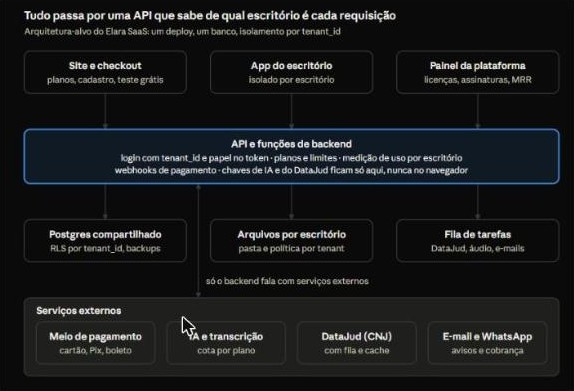
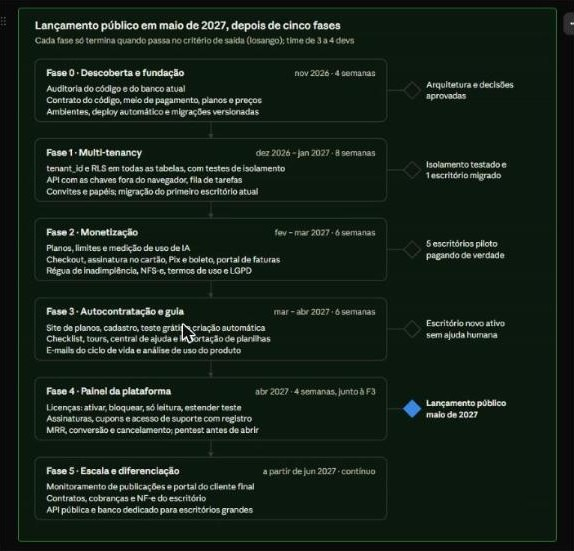

# RoadMap

## Objetivo e premissas

A proposta é transformar o Elara de uma instalação por escritório em um SaaS multi-tenant em cerca de 6 meses. O lançamento público com autocontratação ficaria para maio de 2027, e a escala viria depois disso.

- **Público:** escritórios de advocacia, que são o domínio do produto. O pedido citou escritórios de contabilidade; se a ideia for também atender contabilidade, isso vira uma decisão de produto à parte.
- **Ponto de partida:** a aplicação roda hoje em Cloudflare Workers com Supabase. Cada escritório conecta o próprio banco colando uma chave do Supabase na tela de configuração inicial.
- **Meta de escala proposta:** chegar a 1.000 escritórios pagantes, o cenário base do estudo de mercado, sem precisar mudar a arquitetura de novo.
- **Estimativas:** consideram um time de 3 a 4 desenvolvedores, mais alguém de produto e design. Com um time diferente, os prazos mudam.

| Dimensão | Hoje (uma versão por escritório) | SaaS |
|---|---|---|
| Banco de dados | Um projeto Supabase por escritório | Um banco compartilhado, isolado por escritório |
| Novo cliente | Instalação e configuração manuais | Cadastro e provisionamento automáticos em minutos |
| Atualizações | Por instância | Um deploy só, para todos os clientes |
| Cobrança | Fora do sistema | Assinatura recorrente no cartão, com bloqueio automático |
| Suporte | Caso a caso | Painel de administração, métricas e guia de uso dentro do produto |

## Diagnóstico do estado atual

O produto já cobre bem o dia a dia jurídico, mas foi montado para um escritório só por instalação. Seis pontos impedem que ele funcione como SaaS. A lista vem da análise das telas; o código ainda não foi auditado, e isso é a primeira entrega da Fase 0.

| Ponto observado | Por que trava o SaaS |
|---|---|
| A tela inicial pede para colar a chave pública do Supabase | Cada cliente tem um banco próprio, montado à mão. Não há cadastro automático nem isolamento centralizado |
| O rodapé diz "versão local (sem deploy)" e o escritório de demonstração é fixo ("Castro & Monteiro") | Não há pipeline de deploy único nem separação entre dados de exemplo e dados reais |
| A IA, a consulta ao DataJud e a transcrição de áudio aparecem como funções da tela | Se forem chamadas pelo navegador, as chaves ficam expostas e não dá para medir nem limitar o uso por cliente |
| Contratos, Procurações, Cobranças e NF-e estão "em desenvolvimento" | São justamente os módulos administrativos que os concorrentes já oferecem |
| Usuários, Permissões e "Sair de todos os dispositivos" já existem | É uma boa base, mas os papéis são de um escritório só. Falta o nível acima: o operador da plataforma |
| Não há cobrança, planos nem limites de uso | Sem isso não dá para vender sozinho, bloquear quem não paga nem controlar o custo de IA |

- Auditar o código: estrutura, onde ficam as chaves, o schema do banco e a cobertura de testes
- Levantar quantos escritórios usam a versão atual e quanto dado cada um tem

## Arquitetura-alvo

A base proposta é um único deploy com um banco Postgres compartilhado. Cada linha do banco carrega o `tenant_id` do escritório, e o RLS garante que um escritório nunca leia dados de outro. Dá para manter o Supabase e o Cloudflare que já estão em uso.

Transcrição do diagrama — **Tudo passa por uma API que sabe de qual escritório é cada requisição.** Arquitetura-alvo do Elara SaaS: um deploy, um banco, isolamento por `tenant_id`.

- **Clientes da API:** Site e checkout (planos, cadastro, teste grátis); App do escritório (isolado por escritório); Painel da plataforma (licenças, assinaturas, MRR).
- **API e funções de backend:** login com `tenant_id` e papel no token; planos e limites; medição de uso por escritório; webhooks de pagamento; chaves de IA e do DataJud ficam só aqui, nunca no navegador.
- **Dados e tarefas:** Postgres compartilhado (RLS por `tenant_id`, backups); Arquivos por escritório (pasta e política por tenant); Fila de tarefas (DataJud, áudio, e-mails).
- **Serviços externos (só o backend fala com eles):** Meio de pagamento (cartão, Pix, boleto); IA e transcrição (cota por plano); DataJud (CNJ) (com fila e cache); E-mail e WhatsApp (avisos e cobrança).

O site, o app e o painel só conversam com a API. É ela que identifica o escritório, aplica os limites do plano e guarda as chaves dos serviços externos.

- **Isolamento:** coluna `tenant_id` em todas as tabelas, políticas RLS no Postgres e testes automáticos que tentam ler dados de outro escritório a cada deploy.
- **Identidade:** o login devolve um token com o escritório e o papel do usuário, com convites, verificação em duas etapas e registro de sessões. Os papéis da plataforma (suporte, financeiro) ficam separados dos papéis do escritório.
- **Planos e limites:** uma tabela de planos com limites (usuários, processos monitorados, armazenamento, créditos de IA), conferida pela API antes de cada ação que consome recurso.
- **Escala:** tarefas pesadas (consulta ao DataJud, transcrição, e-mails, geração de documentos) vão para uma fila com limite por escritório, para um cliente não deixar os outros lentos. Índices compostos começando por `tenant_id`.
- **Ambientes e entrega:** desenvolvimento, homologação e produção separados, migrações de banco versionadas e deploy automático com testes.
- **Observabilidade:** logs e erros sempre marcados com o `tenant_id`, alertas de disponibilidade, backup com restauração para qualquer momento e um ensaio de restauração por mês.
- **LGPD e sigilo:** criptografia em trânsito e em repouso, log de auditoria de acessos, exportação e exclusão dos dados por escritório, e acesso do suporte só com consentimento do cliente.

## Funcionalidades pedidas

As quatro funcionalidades pedidas formam um caminho só: o escritório se cadastra, aprende a usar sozinho, paga, e a operação acompanha tudo pelo painel. Cada uma depende do isolamento por escritório (Fase 1) estar pronto.

### 1. Autocontratação e demonstração

1. Uma página de planos e preços leva ao cadastro: nome, e-mail, celular, número da OAB e, se houver, CNPJ.
2. O e-mail é confirmado e o escritório é criado automaticamente em menos de um minuto, já com o administrador.
3. O cliente começa um período de teste (sugestão: 14 dias) e pode escolher entre começar vazio ou com dados de exemplo, que se apagam com um clique.
4. Durante o teste, avisos dentro do produto e por e-mail levam ao checkout. Quando o teste acaba, a conta fica só para leitura, não é apagada.
5. Proteção contra abuso: captcha, limite de testes por e-mail, CNPJ e OAB, e bloqueio de e-mails descartáveis.

### 2. Guia de uso interativo

- Checklist de primeiros passos com barra de progresso: cadastrar o primeiro cliente, importar processos pela OAB ou pelo número CNJ, convidar a equipe, configurar modelos de documentos e registrar um atendimento.
- Tours guiados por tela, que aparecem no primeiro acesso a cada módulo e podem ser vistos de novo pelo menu de ajuda.
- Estados vazios que ensinam: cada tela sem dados explica para que serve e oferece o primeiro passo.
- Central de ajuda com artigos curtos e vídeos, que pode ser buscada de dentro do produto.
- Importação de planilhas de clientes e processos, para quem vem de planilha ou de outro sistema.
- Cada passo concluído vira um evento medido, para saber onde os escritórios param.

### 3. Painel de administração da plataforma

- Lista de escritórios com plano, situação (teste, ativo, inadimplente, bloqueado, cancelado), data de cadastro, usuários, processos e consumo de IA.
- Ações: ativar, bloquear, colocar só para leitura, estender o teste, trocar de plano, aplicar cupom ou desconto e reenviar convite.
- Gestão de assinaturas: histórico de faturas, tentativas de cobrança, estorno e cancelamento.
- Cadastro de planos, preços, limites e cupons, sem precisar de deploy.
- Acesso de suporte à conta do cliente só com autorização dele, tempo limitado e registro em log.
- Papéis internos (administrador, suporte, financeiro) e registro de todas as ações.
- Indicadores: receita recorrente mensal (MRR), novos cadastros, conversão do teste em assinatura, cancelamentos e inadimplência.

### 4. Pagamento e cobrança recorrente

- Assinatura mensal e anual no cartão de crédito, com o cartão guardado pelo meio de pagamento. A plataforma nunca armazena dados do cartão.
- Pix e boleto como alternativas, principalmente no plano anual, porque muitos escritórios pequenos preferem.
- Troca de plano no meio do ciclo, com cobrança proporcional, mais cupons e período de teste integrados ao checkout.
- Cobrança de inadimplentes: novas tentativas automáticas, e-mails de aviso e uma régua (por exemplo: aviso, depois só leitura no 7º dia, depois bloqueio no 15º dia).
- Notificações do meio de pagamento (webhooks) tratadas uma única vez cada, que atualizam a situação do escritório sozinhas.
- Portal do cliente para trocar cartão, baixar faturas e cancelar.
- Emissão automática da nota fiscal de serviço da mensalidade: é obrigação fiscal da empresa que vende o Elara.

## Funcionalidades novas recomendadas

Além das quatro pedidas, faltam doze funcionalidades para o Elara operar como SaaS e competir com Astrea, ADVBOX e EasyJur. As de Fase 1 e 2 bloqueiam o lançamento; as de Fase 5 são o que diferencia o produto depois.

| Funcionalidade | Por que é necessária | Fase |
|---|---|---|
| Planos e limites por escritório (usuários, processos monitorados, armazenamento, créditos de IA) | Os concorrentes cobram assim, e é o que permite ter planos de preços diferentes | 2 |
| Medição e cotas de uso de IA e de transcrição | O custo de IA cresce com o uso. Sem cota, um cliente pesado dá prejuízo | 1–2 |
| Convites, papéis e assentos dentro do escritório | O dono do escritório gerencia a própria equipe sem chamar o suporte | 1 |
| Exportação completa dos dados e encerramento de conta | Exigência da LGPD e argumento de venda ("seus dados são seus") | 2 |
| Termos de uso, política de privacidade e acordo de tratamento de dados, aceitos no cadastro | Escritórios guardam dados sigilosos de terceiros. Isso é requisito para vender | 2 |
| E-mails da plataforma (boas-vindas, teste acabando, fatura, cobrança falhou) e notificações dentro do produto | Fazem a conversão e a cobrança funcionarem sem alguém da equipe | 2–3 |
| Importação de planilhas e de outros sistemas, e busca de processos pela OAB | A maior barreira para trocar de sistema é migrar o acervo | 3 |
| Suporte dentro do produto (chat ou chamados) e página pública de status | Com centenas de clientes, o suporte não pode depender de WhatsApp pessoal | 4 |
| Análise de uso do produto (ativação, retenção, uso por módulo) | Mostra onde os escritórios desistem e o que vale melhorar | 3 |
| Concluir Contratos, Cobranças e NF-e do escritório | Hoje estão "em desenvolvimento", e os concorrentes já oferecem | 5 |
| Monitoramento automático de publicações e intimações | É a principal lacuna frente aos grandes, segundo o benchmark | 5 |
| Portal do cliente final do escritório, mais API e webhooks públicos | Diferenciação e venda para escritórios maiores | 5 |

## Roadmap por fases

O lançamento público com autocontratação fica para maio de 2027, cerca de 6 meses depois do início. A ordem segue as dependências: sem isolamento não dá para cobrar, e sem cobrança não dá para abrir o cadastro.

Transcrição do diagrama — **Lançamento público em maio de 2027, depois de cinco fases.** Cada fase só termina quando passa no critério de saída (losango); time de 3 a 4 devs.

| Fase | Quando | Entregas | Critério de saída |
|---|---|---|---|
| Fase 0 · Descoberta e fundação | nov 2026 · 4 semanas | Auditoria do código e do banco atual; contrato do código, meio de pagamento, planos e preços; ambientes, deploy automático e migrações versionadas | Arquitetura e decisões aprovadas |
| Fase 1 · Multi-tenancy | dez 2026 – jan 2027 · 8 semanas | `tenant_id` e RLS em todas as tabelas, com testes de isolamento; API com as chaves fora do navegador, fila de tarefas; convites e papéis; migração do primeiro escritório atual | Isolamento testado e 1 escritório migrado |
| Fase 2 · Monetização | fev – mar 2027 · 6 semanas | Planos, limites e medição de uso de IA; checkout, assinatura no cartão, Pix e boleto, portal de faturas; régua de inadimplência, NFS-e, termos de uso e LGPD | 5 escritórios piloto pagando de verdade |
| Fase 3 · Autocontratação e guia | mar – abr 2027 · 6 semanas | Site de planos, cadastro, teste grátis, criação automática; checklist, tours, central de ajuda e importação de planilhas; e-mails do ciclo de vida e análise de uso do produto | Escritório novo ativo sem ajuda humana |
| Fase 4 · Painel da plataforma | abr 2027 · 4 semanas, junto à F3 | Licenças: ativar, bloquear, só leitura, estender teste; assinaturas, cupons e acesso de suporte com registro; MRR, conversão e cancelamentos; pentest antes de abrir | **Lançamento público maio de 2027** |
| Fase 5 · Escala e diferenciação | a partir de jun 2027 · contínuo | Monitoramento de publicações e portal do cliente final; contratos, cobranças e NF-e do escritório; API pública e banco dedicado para escritórios grandes | — |

As Fases 3 e 4 correm em paralelo no fim. A Fase 5 começa com os itens do benchmark que mais pesam na venda: publicações e portal do cliente. Os módulos novos ficam congelados até o lançamento, para não atrasar a fundação.

## Decisões e riscos

Três decisões precisam sair na Fase 0, porque o resto depende delas: quem é dono do código, qual meio de pagamento usar e como o banco vai isolar os escritórios.

| Decisão ou risco | Por que importa | Recomendação |
|---|---|---|
| Quem é dono do código (o rodapé traz " 2026 Luana Fernandes Miranda") | Investir em um SaaS sem ter os direitos do código expõe a empresa | Formalizar cessão ou licença antes da Fase 1 |
| Meio de pagamento | Precisa ter assinatura recorrente no cartão, Pix e boleto, webhooks e, de preferência, emissão de NFS-e | Comparar Stripe, Asaas, Iugu e Pagar.me em recursos e taxas antes de escolher |
| Isolamento: banco compartilhado ou banco por escritório | Banco por escritório não escala na operação; banco compartilhado exige cuidado com o isolamento | Banco compartilhado com `tenant_id` e RLS; banco dedicado só como opção para clientes grandes |
| Teste com ou sem cartão | Sem cartão entram mais testes; com cartão a conversão é maior | Começar sem cartão e medir |
| Dado de um escritório aparecer para outro | É o risco mais grave: o sigilo profissional do advogado e a LGPD estão em jogo | Testes automáticos de RLS em todas as tabelas, revisão de código obrigatória e pentest antes do lançamento |
| Migrar os escritórios que já usam a versão atual | Cada um tem o próprio Supabase; uma migração malfeita perde dados | Script de migração testado em cópia, janela combinada com o cliente e conferência de contagens |
| Custo de IA e transcrição fora de controle | O custo varia com o uso e pode passar do valor da mensalidade | Cotas por plano, medição por escritório e alertas de consumo |
| Limites da API pública do DataJud | Muitos escritórios consultando ao mesmo tempo podem ser bloqueados | Fila com limite de requisições, cache e atualização em lote fora do horário de pico |
| Escopo crescer e atrasar o lançamento | Os módulos novos competem com a fundação SaaS | Congelar os módulos novos até a Fase 3 terminar |

- Definir quem é dono do código e assinar o contrato
- Escolher o meio de pagamento
- Definir planos, preços e limites a partir do benchmark de concorrentes

## Métricas de sucesso

O painel de administração precisa mostrar estas métricas desde o lançamento. As metas são propostas iniciais, para ajustar depois dos primeiros 90 dias.

| Métrica | Definição | Meta inicial proposta |
|---|---|---|
| Tempo até o escritório estar pronto | Do cadastro até o escritório criado e acessível | Menos de 2 minutos |
| Ativação | % de testes que completam o checklist de primeiros passos em 7 dias | 40% |
| Conversão do teste | % de testes que viram assinatura paga | 15% |
| Novos escritórios pagantes | Assinaturas novas no mês | 1.041 pagantes em 18 meses (cenário base do estudo de mercado) |
| Receita recorrente mensal (MRR) | Soma das mensalidades ativas | Acompanhar mês a mês |
| Cancelamento mensal | % de escritórios pagantes que cancelam no mês | Menos de 3% |
| Inadimplência | % do MRR com cobrança falhando por mais de 7 dias | Menos de 5% |
| Custo por escritório | Infraestrutura mais IA, dividido pelos escritórios ativos | Menos de 20% do ticket médio |
| Disponibilidade | Tempo no ar por mês | 99,9% |
| Vazamento entre escritórios | Incidentes de dado de um escritório visível para outro | *(vazio no original)* |
